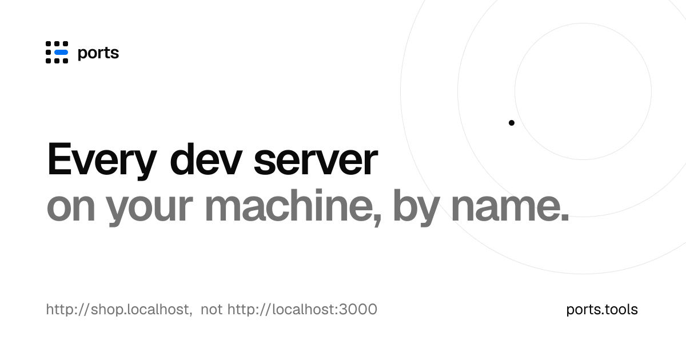

<p align="center">
  <a href="https://ports.tools">
    
  </a>
</p>

# ports

**Every dev server on your machine, by name.**

[**ports.tools**](https://ports.tools) · [Docs](https://ports.tools/docs/commands) · [Releases](https://github.com/pyjeebz/ports/releases)

`ports` finds every dev server on your machine and gives it a name — `http://shop.localhost` instead of `http://localhost:3000`. Start servers the way you already do, from a terminal, an editor, `docker compose` or a coding agent: there's nothing to wrap and nothing to declare. See what's running, reach it by name, stop it safely. For people and coding agents.

```
$ ports
PORT   PROCESS      PROJECT           UPTIME   URL
3000   Next.js      shop              14m      http://localhost:3000
8000   FastAPI      shop              14m      http://localhost:8000
5432   PostgreSQL   docker: shop-db   2d
5173   Vite         admin             3h       http://localhost:5173

$ ports proxy start
✓ routing *.localhost on :80 — a systemd user unit, started at login

$ ports
PORT   PROCESS      PROJECT           UPTIME   URL
3000   Next.js      shop              14m      http://shop.localhost
8000   FastAPI      shop              14m      http://api.shop.localhost
5432   PostgreSQL   docker: shop-db   2d
5173   Vite         admin             3h       http://admin.localhost

$ ports stop shop
✓ stopped Next.js (:3000)
✓ stopped FastAPI (:8000)
```

None of those servers were started by ports, and none of them restarted: ports found them, and the router gave each one a name.

## Why

Every developer knows this dance:

```
Error: Port 3000 is already in use.

$ lsof -i :3000
COMMAND   PID
node      48391

$ kill -9 48391
```

And still nobody knows what PID 48391 *was*. React? Next.js? A dev server from
yesterday? The database you actually needed? Ports and PIDs are how the
operating system sees your machine — they are not how *you* see it. You see
projects: a frontend, an API, a database that belong together.

Existing tools (`lsof`, `kill-port`, `fkill`) stop at the PID layer — they can
kill a number, but they can't tell you what the number is. `ports` exists to
add the missing context: which framework a process is, which project directory
it belongs to, which container is really behind `docker-proxy`, how long it has
been running. That context is what turns "kill a random PID and hope" into
"stop yesterday's dev server, keep the database."

The tools that do give servers names — local proxies, process managers — only
know the servers you start through them or declare in a config. `ports` starts
from the machine instead: it names what's already running, however it got
there.

## What it does

- **Finds** every dev server, however it was started — a terminal, an editor, `docker compose`, a coding agent — and lists every listening port with the framework, project directory, and uptime, not just a PID; grouped by project by default, or ordered with `--sort port|uptime|process|project`
- **Names what it finds** — `ports proxy` (or `ports proxy start`, in the background from login on) puts each web dev server at `http://<name>.localhost`, whether ports started it or not: `shop.localhost` for a project's app, `api.shop.localhost` for the one in `apps/api`, `ui.shop.localhost` for the same app in a git worktree on `fix/ui`, `web.shop.localhost` for the `web` service of a compose project started there (a `db` service is `db.shop` to stop and wait on, with no URL — it doesn't speak HTTP). A name comes from the project, never the port, so it survives a restart on another port. The router listens on loopback only and refuses any host that isn't one of its names. `ports url api.shop` prints a URL for scripts. Browsers and curl resolve `*.localhost` on their own; for Node, Python and Go on a system whose resolver doesn't, `ports hosts sync` writes the names into `/etc/hosts` (one marked block, via sudo) and `ports doctor` says when that's needed.
- **Picks the port, when you want it to** — you never need it for a name, but `ports run -- npm run dev` picks a free port, hands it to the server the way its framework takes one (`PORT`, or `--port` for Vite, Astro and Angular), and names it for as long as it runs. If the project is already running, it says where instead of starting a second copy. `ports alias stripe 4242` names a port ports can't name on its own.
- **Groups** processes into the applications they belong to, so `frontend :3000`, `api :8000`, and `db :5432` read as one project
- **Unwraps Docker**, naming the real container and compose service instead of `docker-proxy`
- **Stops things safely by name** — `ports stop shop`, `ports stop 3000` — with graceful termination before force. Add `--expect nextjs` and a stop only happens if that's really what holds the port — the guard for scripts and agents, which `PORTS_REQUIRE_EXPECT=1` makes mandatory; `--json` reports each stop as a result object.
- **Finds things** — `ports find postgres` → `5432`
- **Knows your project** — `ports here` shows what's running for the directory you're in, so you (or your coding agent) reuse the dev server that's up instead of starting a second on :3001. Exit 1 when nothing is, so `ports here --port 3000 || npm run dev` just works.
- **Waits for readiness** — `ports wait 3000 --http` blocks until the server actually answers, then prints its row; `--gone` waits until it's free. No sleep-and-retry loops.
- **Opens the page** — `ports open 3000` opens a running server in your browser, after asking it whether it speaks HTTPS or HTTP; `ports open shop` asks which when a project serves more than one
- **Diagnoses** — `ports doctor 3000` explains why a port won't free or a row looks odd: uninterruptible sleep, a zombie, TIME_WAIT sockets, a Windows-side listener — findings and the command that fixes each, never an action taken on its own. Bare `ports doctor` checks the whole machine.
- **Watches** — `ports --watch` redraws the table live until you interrupt it (still a foreground loop: it dies with its terminal, never a daemon)
- **Speaks JSON** (`--json`) so scripts and coding agents can ask what's running
- **Serves coding agents over MCP** — `ports mcp` gives an agent `list`, `here`, `find`, `url`, `wait`, `stop` and `doctor` as tools, each the CLI's own JSON and exit code. `stop` always needs `expect`, and the MCP server starts nothing: agents start servers with `ports run`.

## Principles

- **Routes, and runs only what you ask it to** — ports gives your dev servers names and routes to them, but it never starts a server on its own and never installs anything without asking. It runs a command only when you hand it one, and the router listens on loopback only. It doesn't restart crashed servers, collect logs or supervise anything: there are plenty of process managers, and this is not one.
- **Zero config** — no manifest, nothing to declare. All context, names included, is inferred from the machine itself. Useful sixty seconds after install, on a machine in whatever state it's in. (An optional `ports-config.yaml` can extend detection with your own framework rules and project markers — an extension layer, never a requirement.)
- **Local-first** — a single static binary. No cloud, no accounts, no telemetry.

## Install

**curl** (macOS, Linux):

```
curl -fsSL https://ports.tools/install | sh
```

**npm** (macOS, Linux, Windows):

```
npm i -g @pyjeebz/ports
```

**Homebrew** (macOS):

```
brew install pyjeebz/tap/ports
```

**Scoop** (Windows):

```
scoop bucket add pyjeebz https://github.com/pyjeebz/scoop-bucket
scoop install ports
```

Or grab a binary from the [releases page](https://github.com/pyjeebz/ports/releases), or `go install github.com/pyjeebz/ports@latest`. Every release archive also carries man(1) pages for the whole command tree — the curl installer puts them on your `MANPATH` when it can.

Full documentation lives at [ports.tools](https://ports.tools).
