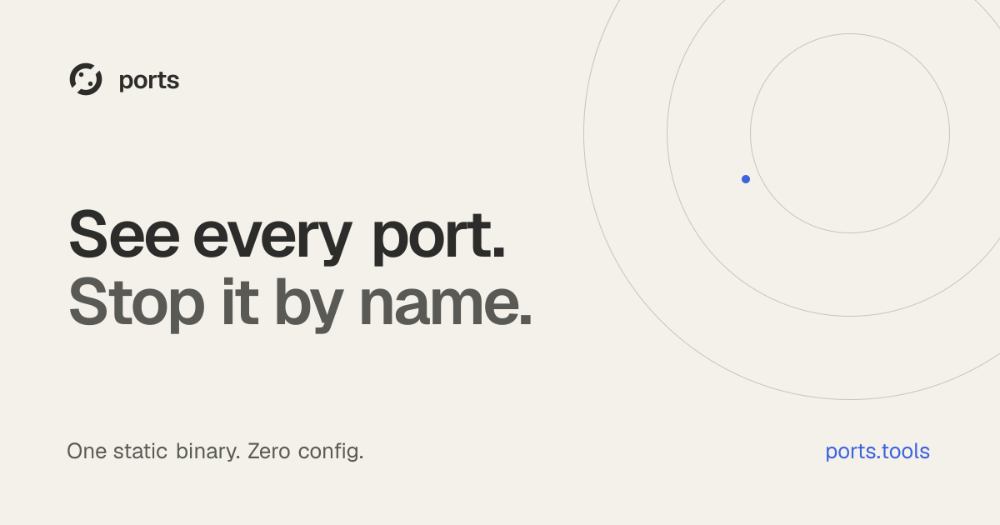

<p align="center">
  <a href="https://ports.tools">
    
  </a>
</p>

# ports

**See what's running on your machine, by project — and kill it by name.**

[**ports.tools**](https://ports.tools) · [Docs](https://ports.tools/docs) · [Releases](https://github.com/pyjeebz/ports/releases)

`ports` answers one question, instantly and with zero configuration: *what is running on this machine right now, and what does it belong to?*

```
$ ports
PORT   PROCESS      PROJECT           UPTIME
3000   Next.js      shop              14m
5432   PostgreSQL   docker: shop-db   2d
8000   FastAPI      shop              14m
5173   Vite         admin             3h

$ ports kill shop
✓ stopped Next.js (:3000)
✓ stopped FastAPI (:8000)

$ ports free 3000
✓ killed Next.js (pid 48391) — port 3000 is free
```

## Why

Every developer knows this dance:

```
Error: Port 3000 is already in use.

$ lsof -i :3000
COMMAND   PID
node      48391

$ kill -9 48391
```

And still nobody knows what PID 48391 *was*. React? Next.js? A dev server from
yesterday? The database you actually needed? Ports and PIDs are how the
operating system sees your machine — they are not how *you* see it. You see
projects: a frontend, an API, a database that belong together.

Existing tools (`lsof`, `kill-port`, `fkill`) stop at the PID layer — they can
kill a number, but they can't tell you what the number is. `ports` exists to
add the missing context: which framework a process is, which project directory
it belongs to, which container is really behind `docker-proxy`, how long it has
been running. That context is what turns "kill a random PID and hope" into
"stop yesterday's dev server, keep the database."

## What it does

- **Lists** every listening port with the framework, project directory, and uptime — not just a PID — grouped by project by default, or ordered with `--sort port|uptime|process|project`
- **Groups** processes into the applications they belong to, so `frontend :3000`, `api :8000`, and `db :5432` read as one project
- **Unwraps Docker**, naming the real container and compose service instead of `docker-proxy`
- **Stops things safely by name** — `ports kill <project>`, `ports free <port>` — with graceful termination before force. Add `--expect nextjs` and a stop only happens if that's really what holds the port — the guard for scripts and agents; `--json` reports each stop as a result object.
- **Finds things** — `ports find postgres` → `5432`
- **Knows your project** — `ports here` shows what's running for the directory you're in, so you (or your coding agent) reuse the dev server that's up instead of starting a second on :3001. Exit 1 when nothing is, so `ports here --port 3000 || npm run dev` just works.
- **Waits for readiness** — `ports wait 3000 --http` blocks until the server actually answers, then prints its row; `--gone` waits until it's free. No sleep-and-retry loops.
- **Diagnoses** — `ports doctor 3000` explains why a port won't free or a row looks odd: uninterruptible sleep, a zombie, TIME_WAIT sockets, a Windows-side listener — findings and the command that fixes each, never an action taken on its own. Bare `ports doctor` checks the whole machine.
- **Diffs against a saved moment** — `ports --format snapshot > before.json`, then `ports diff before.json` names what's new, what's gone, and what restarted since. Exit 1 when anything changed, so `ports diff before.json || ./investigate.sh` gates naturally.
- **Watches** — `ports --watch` redraws the table live until you interrupt it (still a foreground loop: it dies with its terminal, never a daemon)
- **Speaks JSON** (`--json`) so scripts and coding agents can ask what's running

## Principles

- **Observer, never a runner** — it never starts, supervises, or installs anything. Read-only plus targeted kill. There are plenty of process managers; this is not one, and it never will be.
- **Zero config** — no manifest, no daemon, nothing to declare. All context is inferred from the machine itself. Useful sixty seconds after install, on a machine in whatever state it's in. (An optional `ports-config.yaml` can extend detection with your own framework rules and project markers — an extension layer, never a requirement.)
- **Local-first** — a single static binary. No cloud, no accounts, no telemetry.

## Install

**Homebrew** (macOS):

```
brew install pyjeebz/tap/ports
```

**Scoop** (Windows):

```
scoop bucket add pyjeebz https://github.com/pyjeebz/scoop-bucket
scoop install ports
```

**curl** (Linux, macOS):

```
curl -fsSL https://ports.tools/install | sh
```

Or grab a binary from the [releases page](https://github.com/pyjeebz/ports/releases), or `go install github.com/pyjeebz/ports@latest`. Every release archive also carries man(1) pages for the whole command tree — the curl installer puts them on your `MANPATH` when it can.

Full documentation lives at [ports.tools/docs](https://ports.tools/docs).
